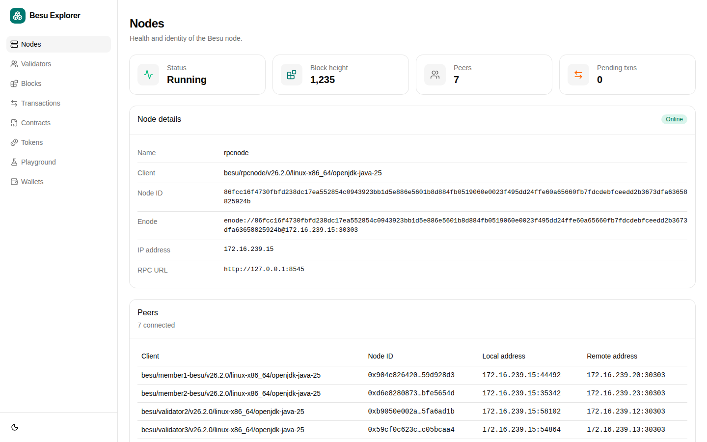
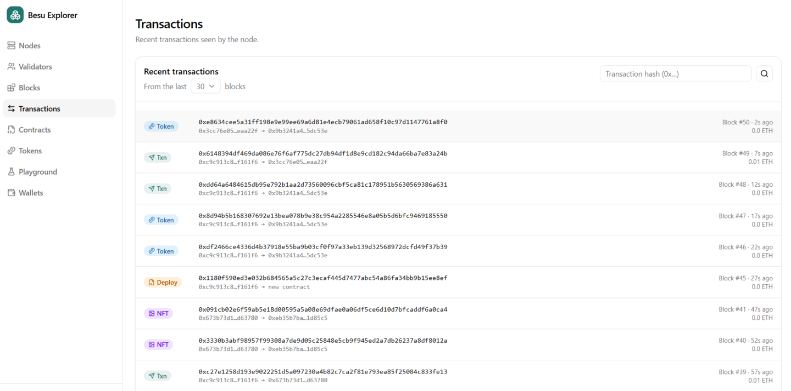
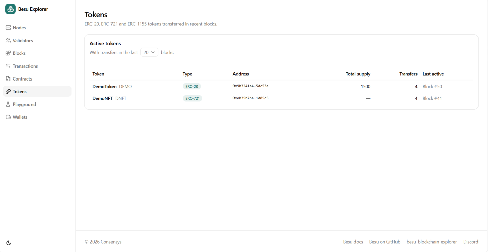
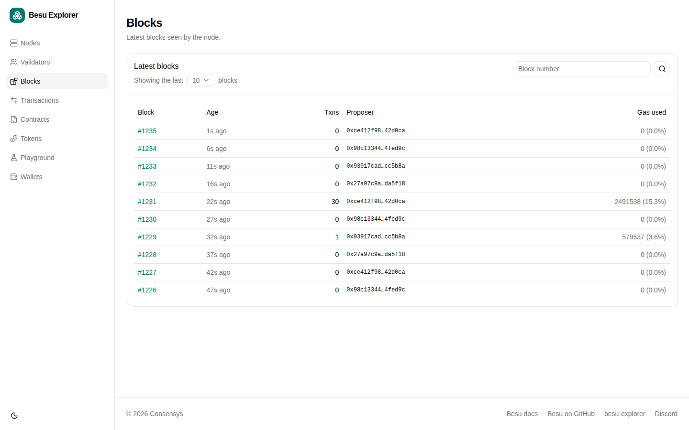
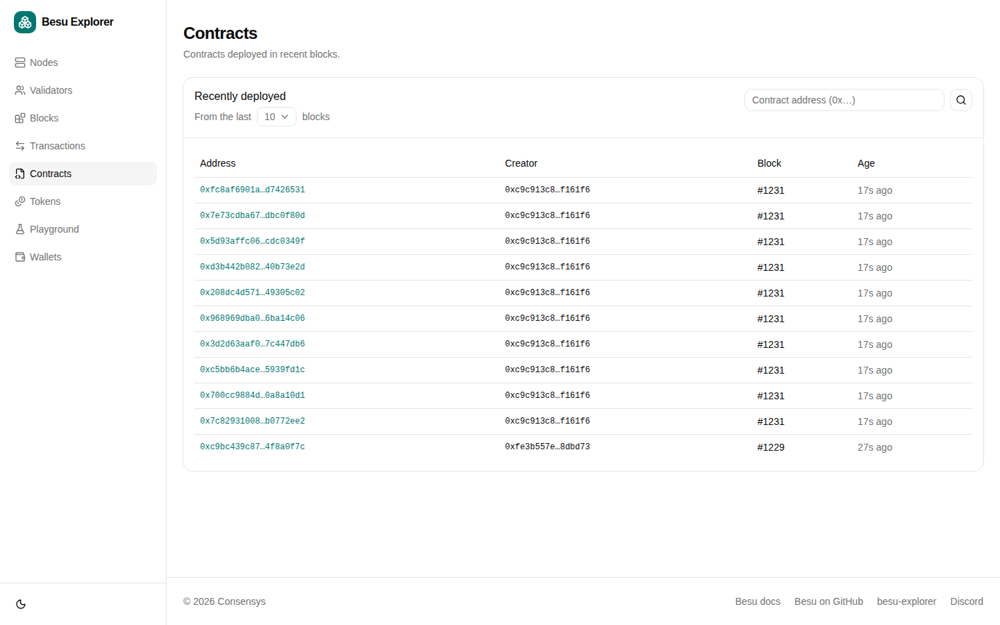
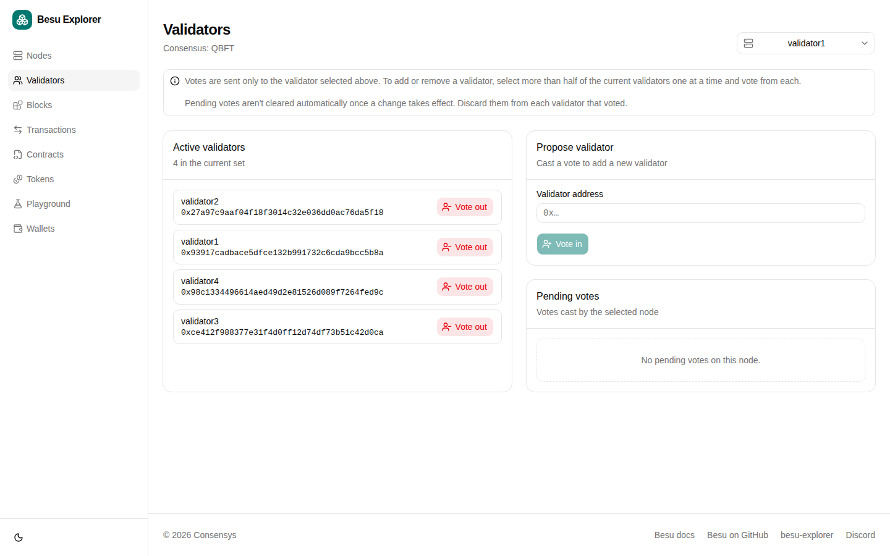
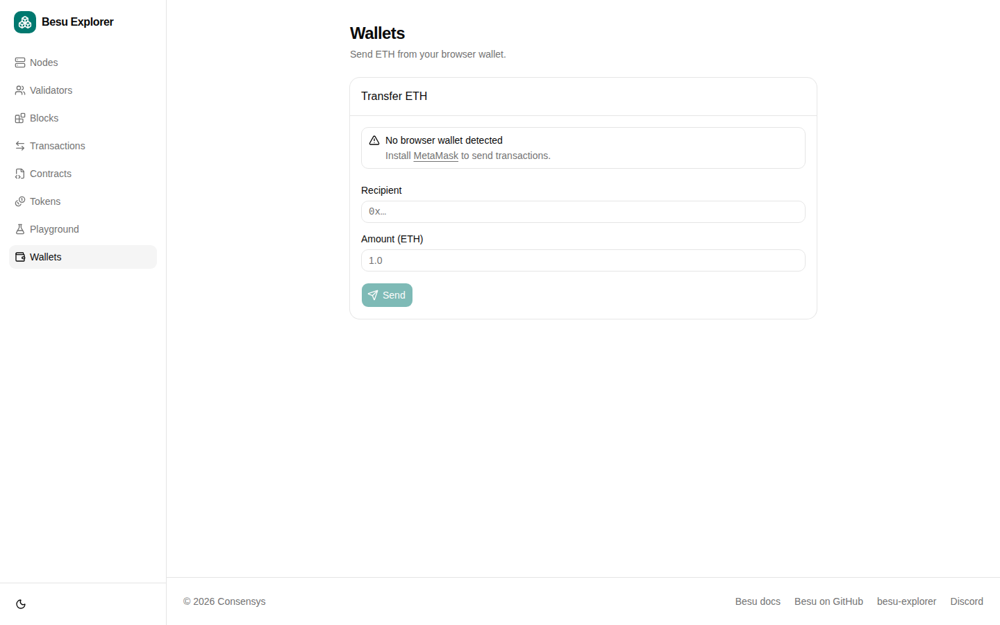
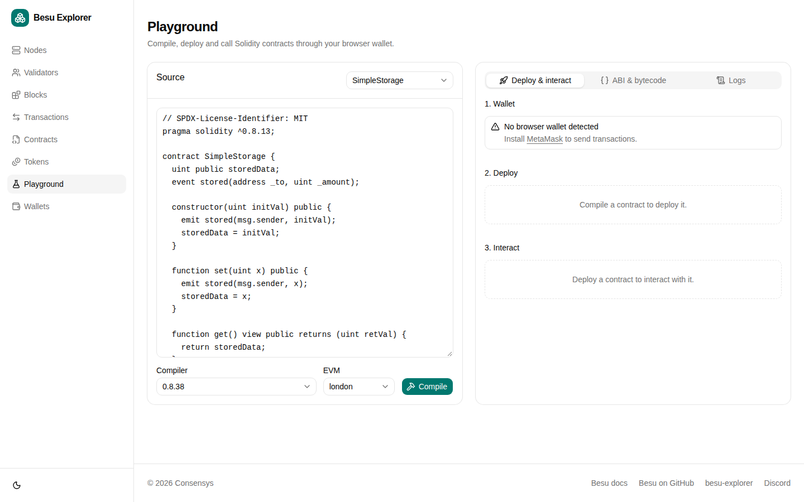

# Use Besu Blockchain Explorer

Besu Blockchain Explorer is a lightweight blockchain explorer for private Besu networks.
The [Developer Quickstart](../../tutorials/quickstart.md) starts Besu Blockchain Explorer with every private network it generates.

Besu Blockchain Explorer reads directly from a Besu JSON-RPC endpoint, so it doesn't need a separate indexing database.
You can use it to view blocks, transactions, contracts, ERC-20 tokens, NFTs, nodes, and QBFT validators.



:::caution

The Developer Quickstart runs Besu Blockchain Explorer with authentication disabled, and the **Validators** page can propose and discard validator votes.
Use this configuration only for development and demonstration networks.
In production networks, you must [secure access](../../../public-networks/how-to/use-besu-api/authenticate.md) to RPC nodes.

:::

## Prerequisites

- [Docker and Docker Compose](https://docs.docker.com/compose/install/) v2 or later
- [Node.js](https://nodejs.org/en/download/), to run the sample transaction scripts

## Start Besu Blockchain Explorer

Generate a private network using the Developer Quickstart:

```bash
npx @consensys/besu-dev-quickstart --networkType private --outputPath ./besu-test-network
```

Start the generated network:

```bash
cd besu-test-network
./run.sh
```

When startup finishes, the services list includes the Besu Blockchain Explorer endpoint:

```log
Besu Explorer (private network)       : http://localhost:25000/explorer
```

Open `http://localhost:25000/explorer` in your browser.

The quickstart configures Besu Blockchain Explorer to read from `rpcnode` (`http://localhost:8545`).
Besu Blockchain Explorer starts after `rpcnode` passes its health check.

## Generate sample activity

A new network contains only empty blocks.
The generated `smart_contracts` directory includes scripts that deploy contracts and send transactions so you have activity to inspect.

The scripts run on the host machine and send transactions to `rpcnode` at `http://127.0.0.1:8545`, signed with the `rpcnode` test account.

Install the dependencies and compile the contracts:

```bash
cd smart_contracts
npm install
npm run compile
```

Run any of the following scripts:

| Command              | Contract             | What the script does                                                                                                                                 |
| -------------------- | -------------------- | ---------------------------------------------------------------------------------------------------------------------------------------------------- |
| `npm run public-tx`  | `SimpleStorage.sol`  | Deploys the contract with an initial value of `47`, reads the value, sets it to `123`, and reads it again.                                            |
| `npm run erc20-tx`   | `ERC20Token.sol`     | Deploys the `DemoToken` (`DEMO`) ERC-20 token with a supply of 1000, mints 500, transfers 200 to a new account, then approves and calls `transferFrom` for 100. |
| `npm run nft-tx`     | `ERC721Token.sol`    | Deploys the `DemoNFT` (`DNFT`) ERC-721 collection, mints two NFTs, transfers both to a new account (one directly and one with `approve` and `transferFrom`), and burns one. |

The ERC-20 and NFT scripts create a new random recipient account on each run and send it 0.01 ETH so it can submit its own transactions.

For example, run the public transaction script:

```bash
npm run public-tx
```

The output resembles the following:

```log title="Public transaction output"
=== PUBLIC CONTRACT DEMO ===

Using account: <rpcnode-account-address>

1. Deploying SimpleStorage with initVal=47 ...
  Contract deployed at: <contract-address>

2. Reading constructor-initialized value ...
  get() => 47

3. Setting value to 123 ...
  set(123) mined — txHash: <transaction-hash>

4. Verifying updated value ...
  get() => 123

=== DONE ===
```

Each script prints the contract address and the hash of each transaction it sends.
Copy these values to search for them in Besu Blockchain Explorer.

## View transactions

The **Transactions** page shows recent transactions seen by the node, newest first.
Use **From the last** to choose how many recent blocks to include.

Each transaction is labeled with its category:

- **Deploy** - A contract creation transaction, such as the first transaction from each script.
- **Token** - A transaction that emits an ERC-20 `Transfer` event, such as the mint and transfers from `erc20-tx`.
- **NFT** - A transaction that emits an ERC-721 or ERC-1155 transfer event, such as the mint, transfers, and burn from `nft-tx`.
- **Txn** - Any other transaction, such as the `set(123)` call from `public-tx` or a plain ETH transfer.

To find a specific transaction, enter its hash in **Search by transaction hash**, or select a row in the list.
The transaction details include the hash, block number and hash, sender (**From**), value, gas limit, gas price, nonce, transaction type, index in the block, and input data.



## View tokens and NFTs

The **Tokens** page lists the ERC-20, ERC-721, and ERC-1155 tokens transferred in recent blocks.
Use **With transfers in the last** to choose how many recent blocks to include.
Besu Blockchain Explorer detects tokens from their transfer events, so a token appears after its first mint or transfer.

The **Active tokens** table shows each token's name, type, contract address, total supply, number of transfers, and when it was last active.
After you run the sample scripts, the list includes:

- `DemoToken` (`DEMO`) with type **ERC-20**, from `erc20-tx`.
- `DemoNFT` (`DNFT`) with type **ERC-721**, from `nft-tx`.
  The sample NFT contract doesn't implement `totalSupply`, so the **Total supply** column shows a dash.

Select a token to view its details, including its name, symbol, decimals, total supply, creator, creation transaction, when it was deployed, and bytecode size.



To view the individual NFT mint, transfer, and burn transactions, look for transactions labeled **NFT** on the **Transactions** page, or search for the transaction hashes printed by `nft-tx`.

## Other pages

Besu Blockchain Explorer also includes the following pages.

The **Blocks** page shows the latest blocks seen by the node.
Search by block number to view the block details, including the transactions in the block.



The **Contracts** page shows contracts deployed in recent blocks.
Search by contract address, for example the address printed by `public-tx`.



The **Nodes** page shows the health and identity of the Besu node, including its client version, enode, chain ID, and peers.

The **Validators** page shows the active validators and pending votes for QBFT, IBFT 2.0, and Clique networks.
You can also propose or discard votes to [add or remove validators](../configure/consensus/qbft.md#add-and-remove-validators).

:::warning

Only use validator voting on development and test networks, never in production.
To send votes, Besu Blockchain Explorer needs access to each validator's own RPC endpoint, and anyone who can access the explorer can vote validators in or out.

:::

The Developer Quickstart enables voting by mounting `config/besu-blockchain-explorer/validators.json`, which lists the RPC endpoint of each validator.
Without this file, the **Validators** page is read-only.



The **Wallets** page sends ETH from a browser wallet such as MetaMask.



The **Playground** page compiles, deploys, and calls Solidity contracts through a browser wallet.



## Stop Besu Blockchain Explorer

Besu Blockchain Explorer runs as part of the generated quickstart network.
Stop the quickstart containers to stop Besu Blockchain Explorer:

```bash
./stop.sh
```
